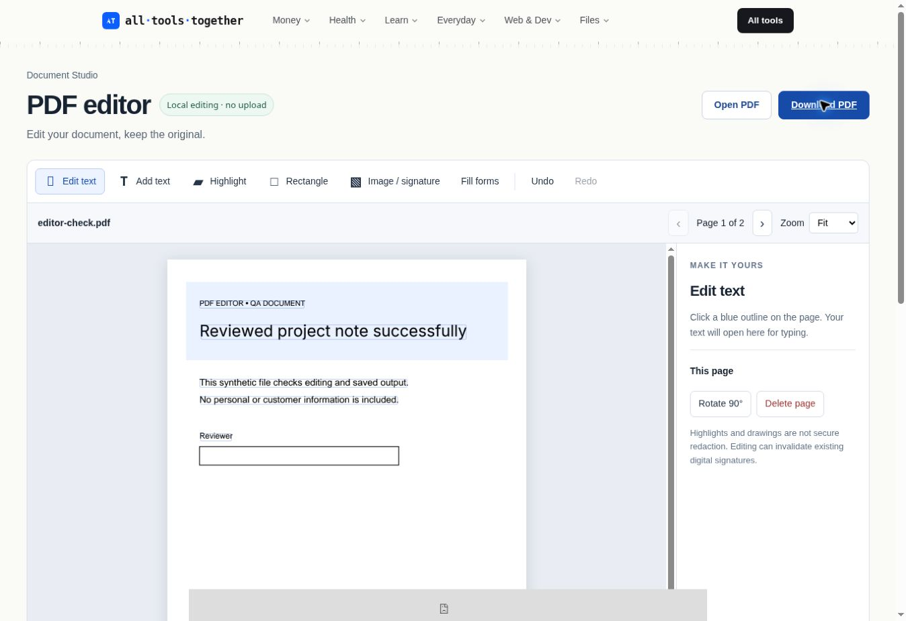

# Our PDF editor — 19 November 2026

The direct PdfCraft/ArtCraft app and its WebGL-gated launcher were removed. Our original React interface is used at /pdf-editor/, /pdf/pdf-editor and in Document Studio. PDFium is an MIT-licensed engine helper, not an embedded editor UI. pdf-lib handles images and standard forms. This editor needs no backend or external API key and does not upload documents.

## Editing and saving

Choose Edit text, click a blue source-text outline, type in Text content, then choose Apply text. The original text object is removed only after its replacement is constructed successfully. It is not hidden beneath a white cover. Add text needs only a page position and stays available on image-only pages.

Inter is embedded for replacement characters. Source font is an explicit alternative, restricted to characters already observed in that font on the page. Source matrices, font size and origin are retained for replacements, including rotated/cropped pages and exporters using a tiny font size with a scaled matrix. Different fonts can still change glyph metrics and spacing.

Unapplied drafts are clearly labeled and excluded from downloads. Undo/redo stores bounded snapshots: 20 versions or approximately 64 MiB, with two recent versions retained. New edits after undo discard the redo branch. The original file on disk is not overwritten.

## Controls and boundaries

The interface supports top-level text replacement/deletion, added multi-line text, font size/color, highlights, rectangles, PNG/JPG insertion, standard form fields, page navigation, fit/zoom, rotation/deletion, undo/redo and PDF download. Read-only form fields remain read-only.

Scans stay pictures. Invisible OCR text is not offered as editable visible text. Grouped Form XObjects stay intact because editing shared forms can affect other placements. Outlined lettering has no text object. PDFium's simple insertion API does not perform complex-script shaping; unsupported text is refused rather than silently written as incorrect glyphs. This does not establish lossless editing for every PDF.

Highlights and drawings are not secure redaction. Text deletion does not certify removal of old data, metadata or revisions. Editing can invalidate existing digital signatures. A signature image is a visual mark, not a cryptographic signature.

## Build and attribution

The preparation script copies only @embedpdf/pdfium 2.15.1 engine bytes and notices from the lockfile installation. It fetches SHA-256-pinned Inter Regular and its SIL OFL notice from the upstream font directory. No upstream editor UI, logo, launcher or OCR model is copied.

Generated assets are gitignored and prepared before dev/test/build. Fetch or checksum failure stops the build. Engine/component licenses, the font license and exact sources are served under /pdf-editor-assets/ and linked from /open-source.

## Verification

The real WASM unit tests cover text replacement/reopening, colored background preservation, source-font refusal, rotated/cropped/scaled coordinates, scan Add Text, images/highlights, page controls, grouped artwork, forms and bounded undo.

The Chromium document workflow disables WebGL and uses production CSP. It types continuously without disabling the text input, applies/reopens text, undoes/redoes, fills a form, downloads/reopens the PDF, checks scan Add Text, and measures loaded layouts at 320–1280px. It checks that no upstream editor canvas or iframe is present.

A deployed preview was also exercised through the browser: a disposable two-page QA PDF was opened, its source heading was replaced, and the resulting PDF was downloaded. Re-reading the actual downloaded bytes with PDFium found the replacement, no original heading object, and the unchanged second page.

